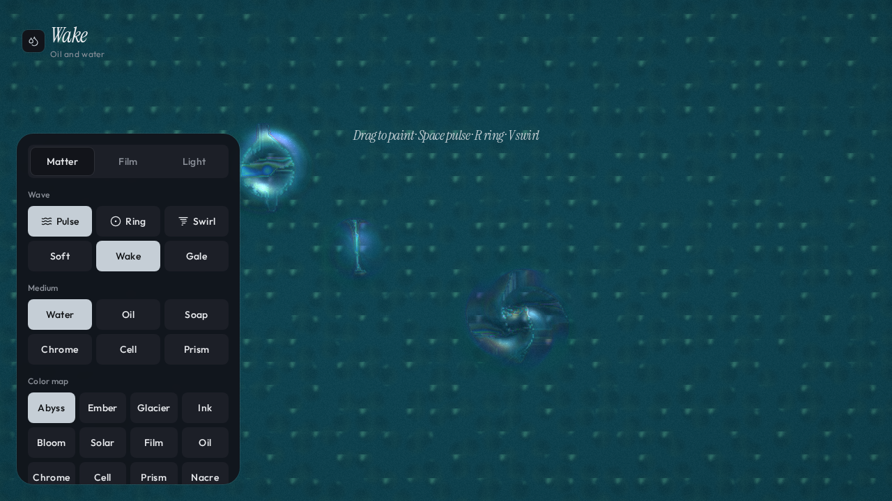

# Wake — viscous fluid simulator

Interactive WebGL2 fluid simulator: drag to stir water, oil, soap and chrome-like liquids with ripples, swirls and rebounds.

**▶ Live demo:** [https://wake-liquid-simulator.vercel.app](https://wake-liquid-simulator.vercel.app) (currently built from the earlier snapshot repo qt314wink/wake-liquid-simulator; see #2)



## Run locally

```bash
npm install
npm run dev
```
